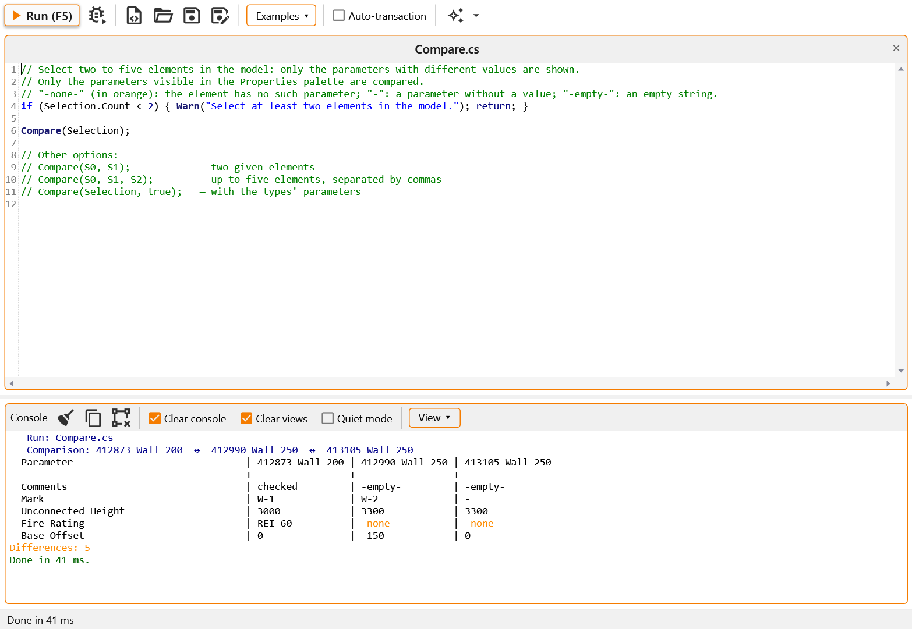

#  Revit DevKit

[](https://github.com/Samveyil/RevitDevKit)
[](https://github.com/Samveyil/RevitDevKit)
[](https://nuke.build/)
[](https://github.com/Samveyil/RevitDevKit/blob/master/LICENSE.txt)
[](README.ru.md)
[](https://github.com/Samveyil/RevitDevKit/releases/latest)

A toolbox for people who write Revit add-ins. Try an idea as a C# script without building anything, run commands from your DLL without restarting Revit, and see why an add-in pulls in the wrong version of a library.



> DevKit speaks English, and Russian in a Russian Revit. To choose, set `"language"` in `%AppData%\RevitDevKit\settings.json` to `"en"` or `"ru"`.

## What's inside

- **Script Editor**: write a few lines of C#, press F5, and they run in the open model. IntelliSense with Revit API docs, Visual Studio debugging, ready-made samples.
- **Help from AI**: one click copies instructions for ChatGPT, Claude or any other chat, so it writes scripts in the right format. Another click sends your script and its errors along.
- **Add-in Explorer**: run `IExternalCommand`s from a DLL that isn't locked, so you rebuild and run again without closing Revit. It can also refresh your add-in's ribbon buttons in place.
- **Startup add-ins**: turn `.addin` files off and on without digging through folders.
- **Assemblies and conflicts**: see everything loaded into Revit and which DLLs clash between add-ins.
- **Drawing geometry**: `Show(solid)` in a script or `Debug.WriteLine(solid)` in your add-in draws it over the model without touching the document.
- **Console**: output, exceptions and Revit warnings in one place.

## Install

Download the `.msi` from [Releases](https://github.com/Samveyil/RevitDevKit/releases/latest) and pick the Revit versions you need. It installs for the current user, no admin rights required.

The add-in shows up on the **Add-Ins** tab as a DevKit panel.

## Quick start

Open **DevKit › Script Editor**, paste this and press F5:

```csharp
var walls = All<Wall>(ActiveView.Id);
Table(walls, w => w.Id, w => w.Name, w => w.Width.ToMillimeters());
Show(walls, Red, "walls in view");
```

You get a table of the walls in the console, and the walls are highlighted in red in the view. No class, no `Execute`, no transaction for reading: the editor adds all of that.

More in the wiki:

- [Script Editor](https://github.com/Samveyil/RevitDevKit/wiki/Script-Editor): script helpers, hotkeys, debugging
- [AI chat](https://github.com/Samveyil/RevitDevKit/wiki/AI-Chat): how to get working scripts from ChatGPT and others
- [Add-in Explorer](https://github.com/Samveyil/RevitDevKit/wiki/Add-in-Explorer): commands, ribbon refresh, startup, assemblies, conflicts
- [Drawing geometry](https://github.com/Samveyil/RevitDevKit/wiki/Drawing-Geometry): `Show` and `Debug.WriteLine`
- [Console](https://github.com/Samveyil/RevitDevKit/wiki/Console)

## License

This project is [licensed](https://github.com/Samveyil/RevitDevKit/blob/master/LICENSE.txt) under the [MIT License](https://en.wikipedia.org/wiki/MIT_License).

---

Do you like this project? Please [star this project on GitHub](https://github.com/Samveyil/RevitDevKit/stargazers), it helps others find it!
