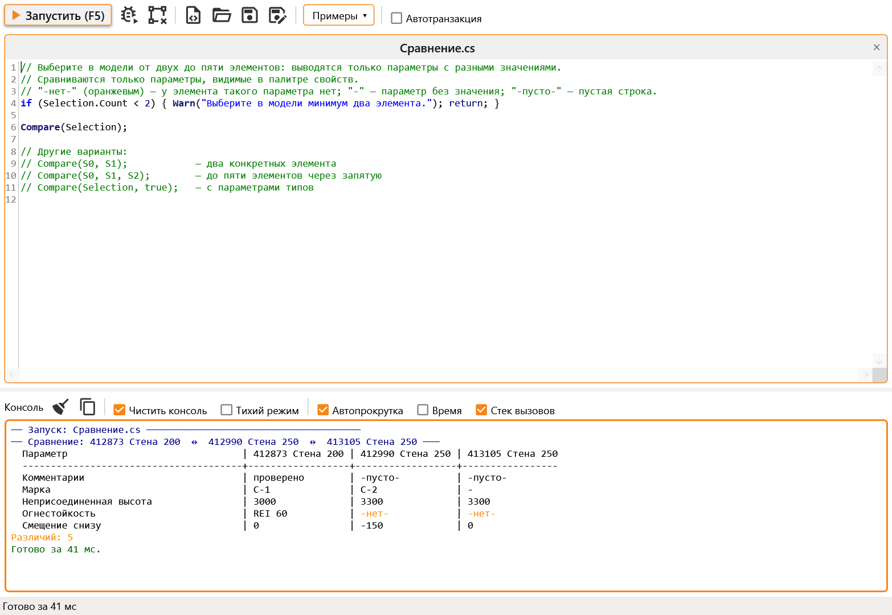
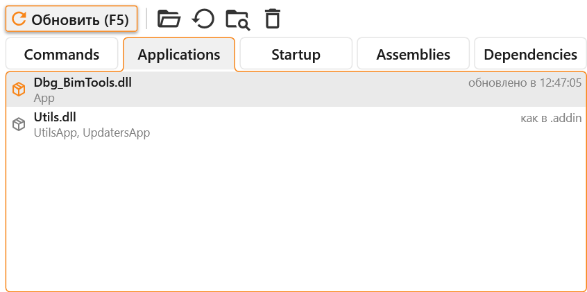
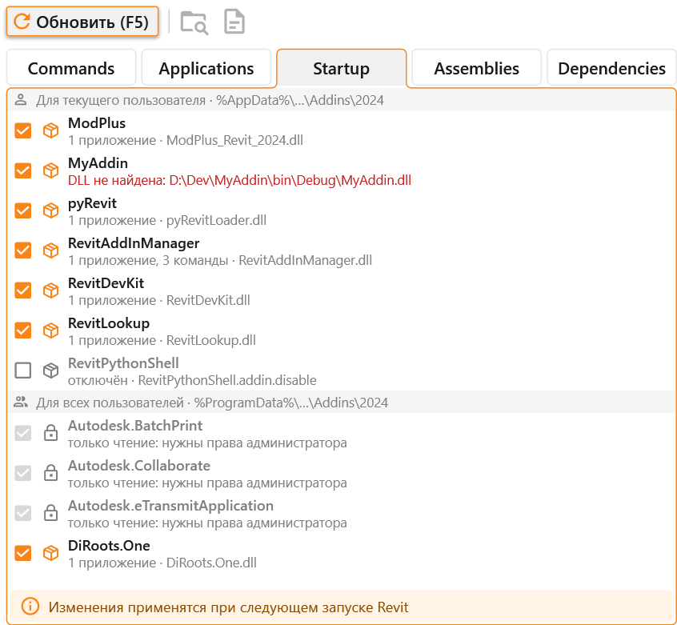
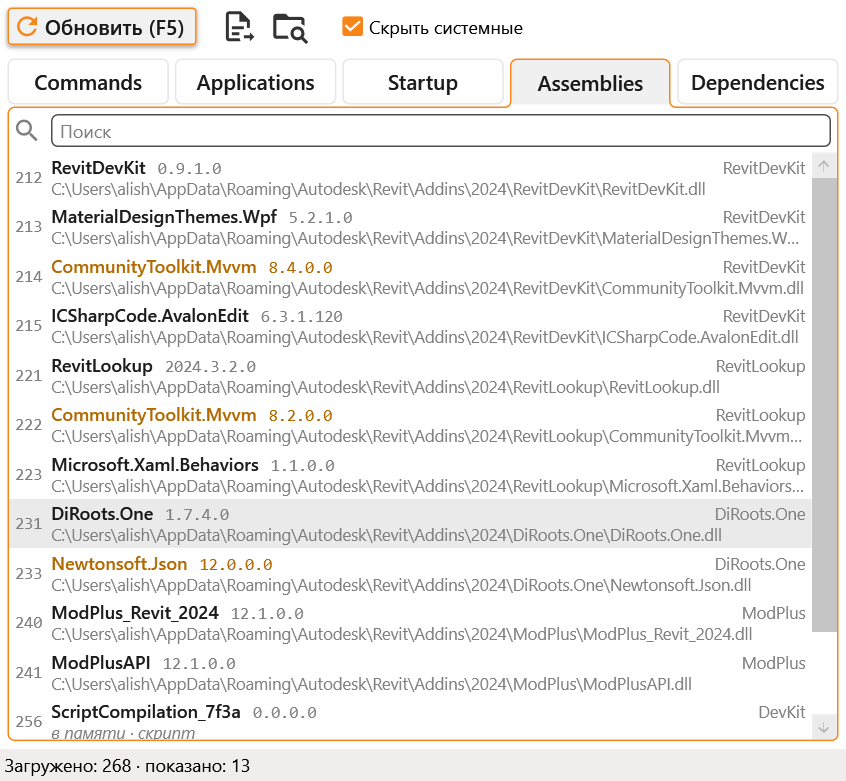
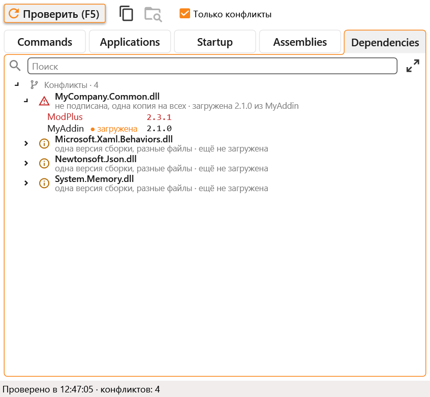
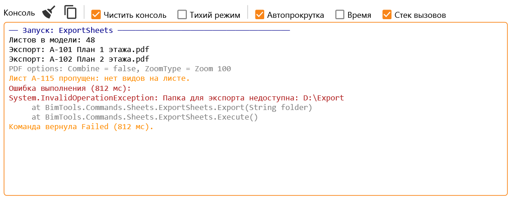

#  Revit DevKit

[](https://github.com/Samveyil/RevitDevKit)
[](https://github.com/Samveyil/RevitDevKit)
[](https://nuke.build/)
[](https://github.com/Samveyil/BIMPlugins.ExtStorage/blob/master/LICENSE)
[](README.ru.md)
[](https://github.com/Samveyil/RevitDevKit/releases/latest)

A Revit 2019–2024 add-in that helps while developing plugins. It has a C# script editor, runs commands from a DLL without restarting Revit, updates ribbon buttons from a new build, turns add-ins on and off, lists the assemblies loaded into Revit, finds DLLs that add-ins bring in clashing versions, and has a console for output.

The add-in's interface is in Russian; the names of its menus and buttons are given below with a translation.

The Add-Ins tab gets a DevKit panel with a pulldown button:

- Script Editor opens the script editor;
- Add-in Explorer opens a window with the commands and applications of a DLL, the add-ins Revit loads at startup, the loaded assemblies and the add-ins' DLLs;
- Repeat Last runs the last script or command once more;
- Repeat Last: Debug runs the last command of a DLL once more under the open Visual Studio;
- Console, after a separator, shows the console pane or hides it when it is open.

## Script Editor



Write code, press F5, and it runs in the current document. A few lines are enough, as in the screenshot: the add-in wraps them in a class and adds the main `using` directives for System, LINQ and the Revit API. If the file declares a class, it is compiled as it is, so you can try a regular `IExternalCommand` or a class with a `Main(Document doc, UIApplication uiapp)` method.

An assembly that Revit does not load can be referenced with `#r`:

```csharp
#r "D:\Libs\MyHelpers.dll"
```

The **Примеры** (Samples) menu has a few ready-made scripts. The **Автотранзакция** (auto transaction) checkbox wraps the run in a transaction, for scripts that change the model without opening one themselves. If a script does not compile, the errors go to the console and the caret moves to the first of them.

Warnings and errors Revit raises when a transaction of the script is committed go to the console, in orange and red, with the transaction's name and the Ids of the elements. The same failure raised several times is one block, its elements numbered by occurrence. Revit still shows them as usual; with **Тихий режим** (quiet mode) ticked in the console's header, warnings are only written to the console and no warning dialog appears, while errors are still shown by Revit. The same works for DLL commands and for Repeat Last.

Scripts are saved to `%AppData%\RevitDevKit\Scripts` unless you pick another folder. A right click on a tab closes it, saves it under another name (**Сохранить как…**, also a toolbar button and Ctrl+Shift+S), and for a tab saved to a file shows the file in Explorer. Repeat Last on the ribbon repeats a script as it was compiled: edits take effect after F5 in the editor.

The bug button next to **Запустить** (Run) runs the script under a debugger. An open Visual Studio is attached to Revit by itself, as Debug › Attach to Process does; with several open, the one whose solution folder holds the script or the DLL. The run stops on the first line of the script, or at the start of `Execute`, `Main` or `Run` of a class. With no Visual Studio open, nothing runs and DevKit asks to open it first. Another debugger, Rider or VS Code, is attached to Revit by hand (Attach to Process), and then the button runs under it. From there F10 and F11 step through the script and breakpoints can be set in it. The debugger shows the script's own file when the tab is saved as it is, otherwise a copy of the text in `%TEMP%\RevitDevKit\Debug`.

The editor suggests as you type: after a dot it lists the members of the type, after `(` it shows the method's overloads with parameter descriptions from the Revit API documentation. After `(` and `,`, and after a space following them, the list opens with what fits the argument on top: `Show(wall, ` puts the colours `Orange`, `Green` and so on first, `new FilteredElementCollector(` puts `Doc` first. After `<` of a generic method the list keeps only the types that fit: `All<` offers element classes, and `walls.OfType<` puts the subclasses of the collection's element first. Brackets `()`, `[]`, `{}`, `<>` of generics and quotes close by themselves, and Enter between `{}` opens a block.

Alt with a mouse selection, or Shift+Alt with the arrow keys, puts a caret on several lines at once, as in Visual Studio. Typed text goes into every line, Tab and Shift+Tab shift them together, and the arrow keys move all the carets. In this mode no suggestions open and no brackets close.

Indentation is coloured by level, as the Indent Rainbow extension for Visual Studio does, with thin guide lines. Indentation that is not a multiple of four spaces is red, so stray spaces on blank lines show too.

| Keys | |
|---|---|
| F5, Ctrl+Enter | run |
| Ctrl+F5 | run under the debugger |
| Ctrl+N, Ctrl+O, Ctrl+S, Ctrl+Shift+S, Ctrl+W | new tab, open, save, save as, close |
| Ctrl+Space | suggestions; the list also opens by itself after a dot and on the first letter of a name |
| Ctrl+Shift+Space | method overloads with parameter descriptions; the window also opens by itself after `(` and `,` |
| Alt + mouse, Shift+Alt+arrows | carets on several lines |
| Ctrl+D | duplicate the line |
| Ctrl+/ | comment or uncomment the lines; a part of one line is wrapped in `/* */` |
| Ctrl+K, Ctrl+C / Ctrl+K, Ctrl+U | comment / uncomment, as in Visual Studio |
| Ctrl+L | clear the console |

Short scripts can use:

| | |
|---|---|
| `Doc`, `UIDoc`, `UIApp`, `App`, `ActiveView` | the document, the application, the active view |
| `Print()`, `Ok()`, `Warn()`, `Fail()` | console output in the normal colour, green, orange and red |
| `Table(items, x => ...)` | a list printed as a table |
| `Tx("Name", () => ...)` | a transaction |
| `All<T>()`, `Instances(category)`, `Types(category)` | elements by class or category, optionally limited to a view |
| `Selection`, `S0`, `S1`, `S(i)` | the selected elements |
| `Dump(element)` | all parameters of an element |
| `Compare(a, b, ...)` | differences in the parameters of 2–5 elements |
| `Show(x)`, `Show(x, Green, "label")`, `ClearShown()` | draw geometry over the model on the views, creating nothing |

```csharp
var walls = All<Wall>();
Print($"Walls in the model: {walls.Count}");

Tx("Mark walls", () =>
{
    foreach (var wall in walls)
        wall.get_Parameter(BuiltInParameter.ALL_MODEL_INSTANCE_COMMENTS)?.Set("checked");
});
```

`Show` draws a point, a curve or an edge, a face, a solid, a mesh, a bounding box, an element, its location or a list of these over the model, through Revit's temporary graphics: nothing goes into the model and there is nothing to undo. Faces are see-through with their edges outlined, a point is a small cross, and every call gets a colour of its own unless one is given (`Orange`, `Green`, `Blue`, `Red`, `Purple`, `Teal`). The console says what each call drew. What is shown stays until the next run, `ClearShown()` or the toolbar button next to the bug. The **Примеры** menu has an example.

In the output of `Compare`, `-нет-` (none) means the element has no such parameter, `-` means the parameter has no value, and `-пусто-` (empty) means an empty string.

## Add-in Explorer

### Commands


Add a built DLL, and its `IExternalCommand` classes appear in the list, grouped by namespace. A double click or F5 runs a command. The DLL file is not locked, so the project can be rebuilt without closing Revit. The command is taken from the DLL on disk every time, so after a build just run it again. The list needs refreshing only when new commands appear: Ctrl+R, or a right click on the DLL, which also removes it from the list. The bug button or Ctrl+F5 runs the command under a debugger: the Visual Studio with the add-in's solution open is attached, and breakpoints set in the project are hit.

The window closes when a command runs. To run the same command again after changes, there is no need to open Add-in Explorer: build the project and press Repeat Last on the ribbon, and the command runs from the fresh DLL. Repeat Last can be given a keyboard shortcut in Revit. **Repeat Last: Debug** next to it repeats the command under the open Visual Studio, as the bug button does, so breakpoints set in the project are hit; it has its own shortcut. A script is debugged in Script Editor instead.

### Applications



Here you can see what an add-in's buttons will look like after changes, without restarting Revit. The add-in is installed as usual with an `.addin` file, and the DLL from the project's build folder is added here. After changes, build the project and press **Обновить** (Refresh): the add-in's buttons on the ribbon change their texts, tooltips, icons and `ShowText`. New buttons and panels appear, removed ones disappear, and a button that became a pulldown is replaced in the same place. A panel the add-in builds through AdWindows itself, on Modify for instance, is updated in place rather than added again.

The old buttons keep running commands from the version Revit loaded, and the new ones run code from the fresh build. After Revit restarts, the ribbon is again what the `.addin` creates. The **Вернуть как было** (Restore) button brings it back without a restart.

The DLL may have a different name than the installed one, for example `Dbg_MyAddin.dll` instead of `MyAddin.dll`, or the same one: windows of the installed add-in and of the fresh build each load their own XAML. Libraries that did not change, MaterialDesign for instance, are loaded once and shared, so their styles fit both.

### Startup



This tab lists the `.addin` files of the running Revit version: the current user's from `%AppData%\Autodesk\Revit\Addins\<year>` and those for all users from `%ProgramData%\Autodesk\Revit\Addins\<year>`. Clearing a checkbox renames `X.addin` to `X.addin.disable`, so Revit does not load the add-in on its next start, and ticking it renames the file back.

Under each name is what the file contains and its DLL, and in red what is wrong: a DLL that is not found or an `.addin` that cannot be read. Files that Windows does not let you rename, usually installers' files for all users, have a lock: changing them needs administrator rights. Before DevKit turns itself off, it asks. A file can be shown in Explorer or opened in Notepad (Ctrl+O). Changes apply at the next start of Revit, as the note at the bottom of the tab says.

### Assemblies



Every assembly loaded into Revit right now, with a number and a path. The number is its place in the `AppDomain`'s list, roughly the load order. On the right is whose it is: an add-in's (by its folder), Revit's, .NET's, the GAC's or DevKit's. Assemblies without a file, such as scripts and DLL commands DevKit loaded from bytes, say **в памяти** (in memory); a copy of a DLL names the file it came from.

Assemblies loaded more than once under the same name are orange, and the tooltip lists every copy. **Скрыть системные** (hide system) hides .NET, the GAC, Revit's own and dynamic assemblies, leaving the add-ins and their DLLs. The list is read again each time the tab opens and on F5. A right click shows an assembly in Explorer or copies its path, and the report button saves the list as shown to a text file in `%TEMP%\RevitDevKit\Reports`, a markdown table, and shows the file in Explorer.

### Dependencies



This tab finds DLLs that several add-ins of the running Revit version, or an add-in and Revit itself, bring in different versions, and shows which of them really clash in the one Revit process they all share:

- **Red**: an add-in gets an older assembly version than it was built against, and may fail. That happens to a DLL without a strong name, where the first copy loaded goes to everyone, and to one that `Revit.exe.config` redirects down to Revit's version. A DLL without a strong name in different versions is always listed among the conflicts, orange when nobody gets an older one now: which copy loads first depends on the order the add-ins load, so next time another add-in may get the older one.
- **Orange**: an add-in gets a newer version (fine if the library only added things), another file of the same assembly version, or a newer version Revit redirects it to. One copy is shared, which is usually harmless.
- With **Только конфликты** (conflicts only) cleared, signed DLLs of different versions show too: .NET loads each add-in its own version, side by side. Revit's redirects count only for the versions their `oldVersion` names.
- DLLs that differ only between Revit and Autodesk's own add-ins are not counted as conflicts, since they cannot be changed anyway. With the box cleared they show under **Только Revit и Autodesk** (Revit and Autodesk only). An add-in is Autodesk's if its `.addin` says `VendorId` `ADSK` or its DLL names Autodesk as the company.

The copy loaded in this session is marked. A right click on a DLL or an add-in shows it in Explorer or copies its path. An add-in's DLLs are the ones in the folder of its assembly, read from their headers without loading them. Language resources (folders such as `en-US` and `*.resources.dll`) are left out: they are the same DLL in another language. The report button saves a markdown report to a text file in `%TEMP%\RevitDevKit\Reports` and shows the file in Explorer.

## Console



Everything that scripts and DLL commands write goes here: `Console.WriteLine`, `Debug.WriteLine`, `Trace` and exceptions with their call stacks. The console opens as a separate Revit pane and is also shown at the bottom of the script editor. The Console button on the ribbon shows the pane, or hides it when it is open. The output can be cleared (Ctrl+L) and copied. Two checkboxes in its header set how runs from Script Editor and Add-in Explorer alike treat it: **Чистить консоль** (clear console) clears it before each run, and **Тихий режим** (quiet mode) keeps Revit's warning dialogs away, writing the warnings here only. The others are **Автопрокрутка** (auto scroll), **Время** (timestamps) and **Стек вызовов** (call stacks), the last one showing call stacks and other debug lines. All of them are one setting for the console in the editor and the console pane: switched in one, they switch in the other.

## License

This project is [licensed](https://github.com/Samveyil/RevitDevKit/blob/master/LICENSE.txt) under the [MIT License](https://en.wikipedia.org/wiki/MIT_License).

---

Do you like this project? Please [star this project on GitHub](https://github.com/Samveyil/RevitDevKit/stargazers)!
