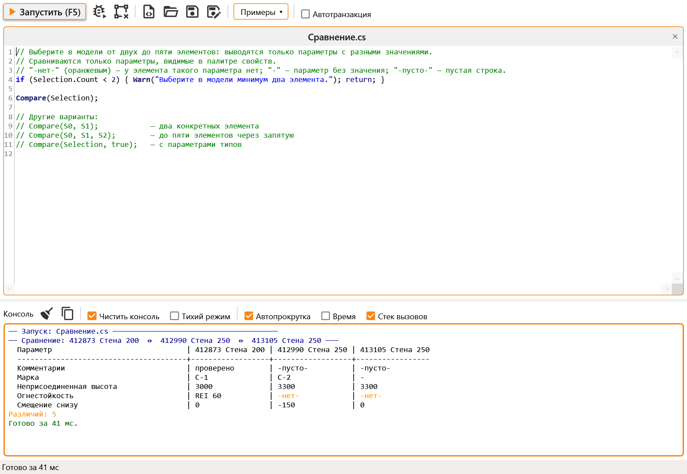
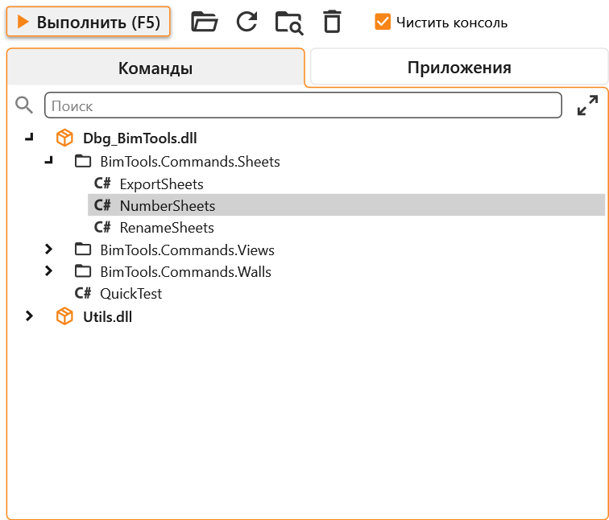
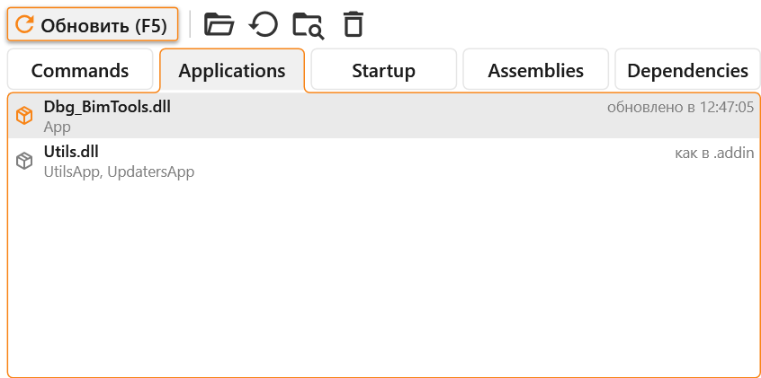
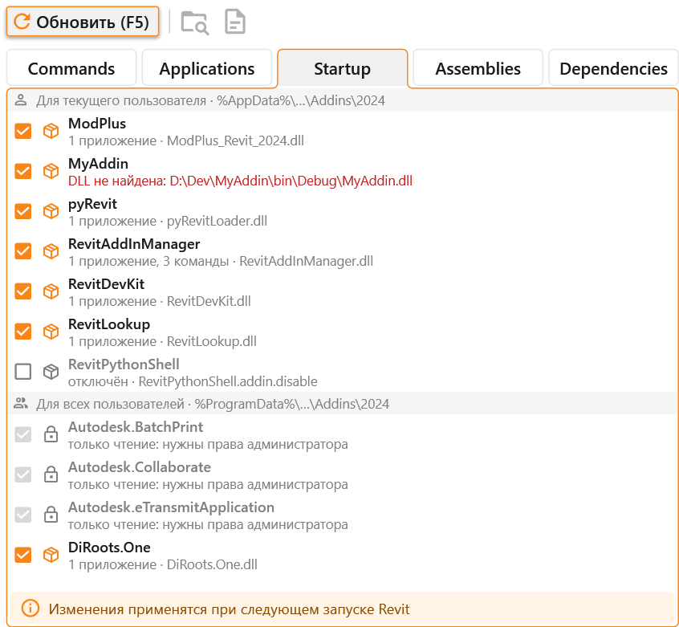
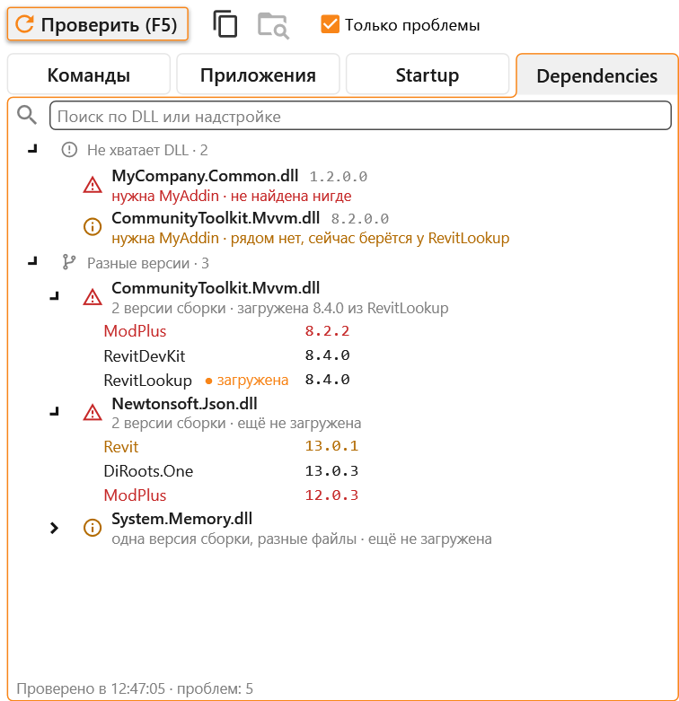
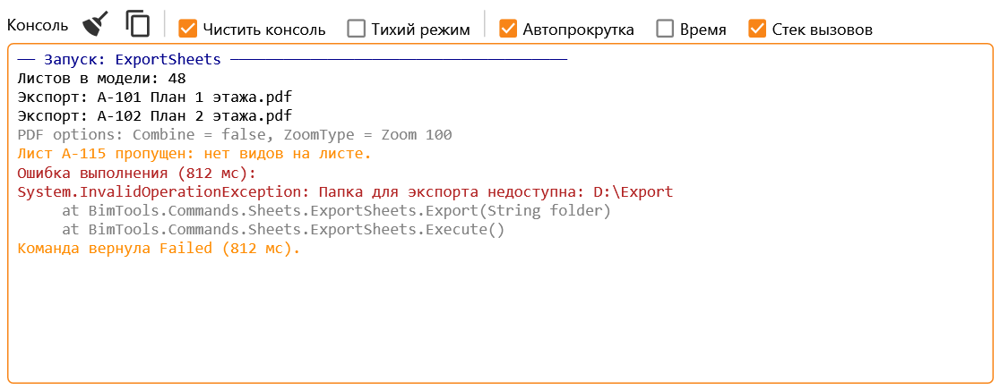

#  Revit DevKit

[](https://github.com/Samveyil/RevitDevKit)
[](https://github.com/Samveyil/RevitDevKit)
[](https://nuke.build/)
[](https://github.com/Samveyil/BIMPlugins.ExtStorage/blob/master/LICENSE)
[](README.md)
[](https://github.com/Samveyil/RevitDevKit/releases/latest)

Надстройка для Revit 2019–2024, которая помогает при разработке плагинов. В ней редактор C#-скриптов, запуск команд из DLL без перезапуска Revit, обновление кнопок на ленте по новой сборке и консоль для вывода.

На вкладке «Надстройки» появляется панель DevKit с выпадающей кнопкой:

- Script Editor открывает редактор скриптов;
- DLL Runner открывает окно с командами и приложениями из DLL, списком надстроек, которые Revit загружает при запуске, и их DLL;
- Run Again повторяет последний запуск;
- Console показывает панель консоли.

## Script Editor



Пишете код, нажимаете F5, и он выполняется в текущем документе. Можно написать просто несколько строк, как на скриншоте. Плагин сам обернёт их в класс и подключит основные `using` для System, LINQ и Revit API. Если в файле объявлен класс, он компилируется как есть: так можно проверить обычный `IExternalCommand` или класс с методом `Main(Document doc, UIApplication uiapp)`.

Сборку, которой нет в Revit, можно подключить через `#r`:

```csharp
#r "D:\Libs\MyHelpers.dll"
```

В меню «Примеры» лежит несколько готовых скриптов. Галочка «Автотранзакция» оборачивает запуск в транзакцию, если скрипт меняет модель и не открывает её сам. Если скрипт не компилируется, ошибки выводятся в консоль, а курсор встаёт на первую из них.

Редактор подсказывает по ходу набора: после точки показывает члены типа, после `(` показывает перегрузки метода с описанием параметров из документации Revit API. После `<` у обобщённого метода в списке остаются только подходящие типы: `All<` предложит классы элементов, а `walls.OfType<` первыми покажет наследники элемента коллекции. Скобки `()`, `[]`, `{}`, `<>` у обобщённых и кавычки закрываются сами, Enter между `{}` открывает блок.

Alt и выделение мышью или Shift+Alt и стрелки ставят курсор сразу на несколько строк, как в Visual Studio. Набранный текст попадает во все строки, Tab и Shift+Tab сдвигают их вместе, стрелки двигают все курсоры. В этом режиме подсказки не открываются и скобки не закрываются.

Отступы раскрашены по уровням, как в расширении Indent Rainbow для Visual Studio, и отмечены тонкими линиями. Отступ, не кратный четырём пробелам, подсвечен красным, поэтому видны и лишние пробелы на пустых строках.

| Клавиши | |
|---|---|
| F5, Ctrl+Enter | запустить |
| Ctrl+N, Ctrl+O, Ctrl+S, Ctrl+W | новая вкладка, открыть, сохранить, закрыть |
| Ctrl+Space | подсказки; список открывается и сам, после точки и на первой букве имени |
| Ctrl+Shift+Space | перегрузки метода с описанием параметров; окно открывается и само, после `(` и `,` |
| Alt + мышь, Shift+Alt+стрелки | курсоры на нескольких строках |
| Ctrl+D | дублировать строку |
| Ctrl+L | очистить консоль |

В коротких скриптах доступны:

| | |
|---|---|
| `Doc`, `UIDoc`, `UIApp`, `App`, `ActiveView` | документ, приложение, активный вид |
| `Print()`, `Ok()`, `Warn()`, `Fail()` | вывод в консоль обычным, зелёным, оранжевым и красным цветом |
| `Table(items, x => ...)` | вывод списка таблицей |
| `Tx("Имя", () => ...)` | транзакция |
| `All<T>()`, `Instances(category)`, `Types(category)` | элементы по классу или категории, можно ограничить видом |
| `Selection`, `S0`, `S1`, `S(i)` | выбранные элементы |
| `Dump(element)` | все параметры элемента |
| `Compare(a, b, ...)` | различия в параметрах у 2–5 элементов |

```csharp
var walls = All<Wall>();
Print($"Стен в модели: {walls.Count}");

Tx("Пометить стены", () =>
{
    foreach (var wall in walls)
        wall.get_Parameter(BuiltInParameter.ALL_MODEL_INSTANCE_COMMENTS)?.Set("проверено");
});
```

В выводе `Compare` надпись `-нет-` значит, что у элемента нет такого параметра, `-` значит, что у параметра нет значения, а `-пусто-` означает пустую строку.

## DLL Runner

### Команды



Добавляете собранную DLL, и в списке появляются её `IExternalCommand`, сгруппированные по пространствам имён. Двойной щелчок или F5 запускает команду. Файл DLL при этом не блокируется, поэтому проект можно пересобирать, не закрывая Revit. Команда каждый раз берётся из текущей DLL на диске, так что после сборки её достаточно просто запустить снова. Кнопка «Обновить» нужна, только если появились новые команды.

Окно при запуске закрывается. Чтобы после правок запустить ту же команду ещё раз, не нужно снова открывать DLL Runner: соберите проект и нажмите на ленте Run Again. Команда запустится из свежей DLL. Кнопке Run Again можно назначить горячую клавишу в Revit.

### Приложения



Здесь можно посмотреть, как будут выглядеть кнопки надстройки после правок, не перезапуская Revit. Надстройка установлена как обычно через `.addin`. Сюда добавляется DLL из папки сборки проекта. После правок проект собирается, и по кнопке «Обновить» кнопки этой надстройки на ленте меняются: тексты, подсказки, иконки, `ShowText`. Новые кнопки и панели появляются, удалённые пропадают, а если обычная кнопка стала выпадающей, она меняется на том же месте.

Старые кнопки продолжают запускать команды из версии, которую загрузил Revit, а новые запускают код из свежей сборки. После перезапуска Revit лента снова будет такой, как её создаёт `.addin`. Вернуть её без перезапуска можно кнопкой «Вернуть как было».

DLL может называться иначе, чем установленная, например `Dbg_MyAddin.dll` вместо `MyAddin.dll`.

### Startup



Здесь собраны `.addin` той версии Revit, в которой открыт DevKit: текущего пользователя из `%AppData%\Autodesk\Revit\Addins\<год>` и для всех пользователей из `%ProgramData%\Autodesk\Revit\Addins\<год>`. Если снять галочку, `X.addin` переименуется в `X.addin.disable`, и при следующем запуске Revit не загрузит надстройку. Если поставить галочку, файл переименуется обратно.

Под именем написано, что в файле и какая DLL, а красным выделено, что не так: DLL не найдена или `.addin` не читается. Файлы, которые Windows не даёт переименовать, обычно это файлы установщиков для всех пользователей, отмечены замком: для их изменения нужны права администратора. Перед тем как отключить сам DevKit, окно спросит подтверждение.

### Dependencies



Здесь проверяются DLL надстроек, которые загружает эта версия Revit, вместе с папкой самого Revit. Все надстройки работают в одном процессе Revit, и библиотека загружается один раз, обычно из той надстройки, которой она понадобилась первой. Поэтому здесь видны два вида проблем:

- **Не хватает DLL**: надстройка ссылается на библиотеку, которой нет в её папке. Красным, если её нет нигде: надстройка упадёт, когда дойдёт до этого кода. Оранжевым, если она работает только потому, что эта библиотека есть у другой надстройки или та её уже загрузила.
- **Разные версии**: у нескольких надстроек, или у надстройки и Revit, одна и та же DLL разных версий. Красным, если отличается версия сборки: загруженная копия может не подойти остальным. Оранжевым, если отличается только версия файла, обычно это безопасно. Копия, загруженная в этом сеансе, отмечена.

DLL надстройки — это DLL в папке её сборки, а ссылки читаются из заголовков DLL без их загрузки. Кнопка копирования кладёт в буфер обмена отчёт в markdown. DLL, которую надстройка загружает по пути своим кодом, проверка не увидит.

## Консоль



Сюда попадает всё, что пишут скрипты и команды из DLL: `Console.WriteLine`, `Debug.WriteLine`, `Trace` и исключения со стеком вызовов. Консоль открывается отдельной панелью Revit и дублируется внизу редактора скриптов. Её можно очистить и скопировать, а время и строки отладки включаются галочками.

## License

This project is [licensed](https://github.com/Samveyil/RevitDevKit/blob/master/LICENSE.txt) under the [MIT License](https://en.wikipedia.org/wiki/MIT_License).

---

Do you like this project? Please [star this project on GitHub](https://github.com/Samveyil/RevitDevKit/stargazers)!
