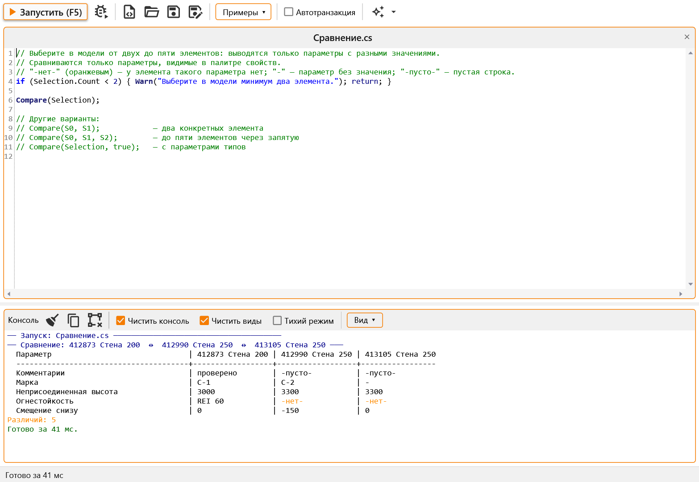

#  Revit DevKit

[](https://github.com/Samveyil/RevitDevKit)
[](https://github.com/Samveyil/RevitDevKit)
[](https://nuke.build/)
[](https://github.com/Samveyil/RevitDevKit/blob/master/LICENSE.txt)
[](README.md)
[](https://github.com/Samveyil/RevitDevKit/releases/latest)

Набор инструментов для тех, кто пишет надстройки для Revit. Проверить идею C#-скриптом без сборки, запускать команды из своей DLL без перезапуска Revit и понять, почему надстройка подхватила не ту версию библиотеки.



## Что внутри

- **Script Editor**: пишете пару строк на C#, жмёте F5, и они выполняются в открытой модели. Подсказки с документацией Revit API, отладка в Visual Studio, готовые примеры.
- **Помощь ИИ**: одной кнопкой копируется инструкция для ChatGPT, Claude или любого другого чата, чтобы он писал скрипты в нужном формате. Второй кнопкой вместе с ней уходят ваш скрипт и его ошибки.
- **Add-in Explorer**: запуск `IExternalCommand` из DLL, которая не блокируется, поэтому пересобрали и запустили снова, не закрывая Revit. Ещё он умеет обновлять кнопки вашей надстройки на ленте на лету.
- **Надстройки при запуске**: включить или выключить `.addin`, не лазая по папкам.
- **Сборки и конфликты**: всё, что загружено в Revit, и какие DLL конфликтуют между надстройками.
- **Рисование геометрии**: `Show(solid)` в скрипте или `Debug.WriteLine(solid)` в надстройке рисует её поверх модели, ничего не создавая в документе.
- **Консоль**: вывод, исключения и предупреждения Revit в одном месте.

## Установка

Скачайте `.msi` из [Releases](https://github.com/Samveyil/RevitDevKit/releases/latest) и отметьте нужные версии Revit. Ставится для текущего пользователя, права администратора не нужны.

Надстройка появится на вкладке **Надстройки** панелью DevKit.

## Быстрый старт

Откройте **DevKit › Script Editor**, вставьте код и нажмите F5:

```csharp
var walls = All<Wall>(ActiveView.Id);
Table(walls, w => w.Id, w => w.Name, w => w.Width.ToMillimeters());
Show(walls, Red, "стены вида");
```

В консоли появится таблица стен, а сами стены подсветятся красным на виде. Класс, `Execute` и транзакция для чтения не нужны — их добавляет редактор.

Подробнее в wiki:

- [Script Editor](https://github.com/Samveyil/RevitDevKit/wiki/Script-Editor-RU): что доступно в скриптах, горячие клавиши, отладка
- [Чат с ИИ](https://github.com/Samveyil/RevitDevKit/wiki/AI-Chat-RU): как получать от ChatGPT и других рабочие скрипты
- [Add-in Explorer](https://github.com/Samveyil/RevitDevKit/wiki/Add-in-Explorer-RU): команды, обновление ленты, автозагрузка, сборки, конфликты
- [Рисование геометрии](https://github.com/Samveyil/RevitDevKit/wiki/Drawing-Geometry-RU): `Show` и `Debug.WriteLine`
- [Консоль](https://github.com/Samveyil/RevitDevKit/wiki/Console-RU)

## License

This project is [licensed](https://github.com/Samveyil/RevitDevKit/blob/master/LICENSE.txt) under the [MIT License](https://en.wikipedia.org/wiki/MIT_License).

---

Нравится проект? Поставьте ему [звезду на GitHub](https://github.com/Samveyil/RevitDevKit/stargazers), так его проще найти другим!
